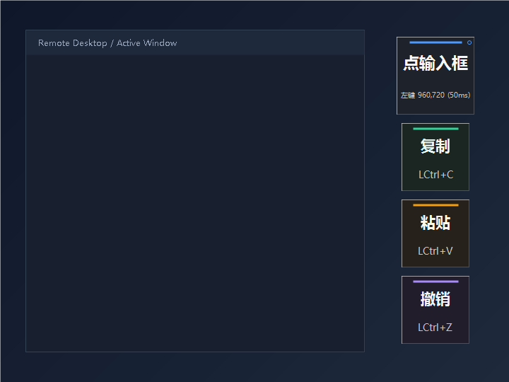
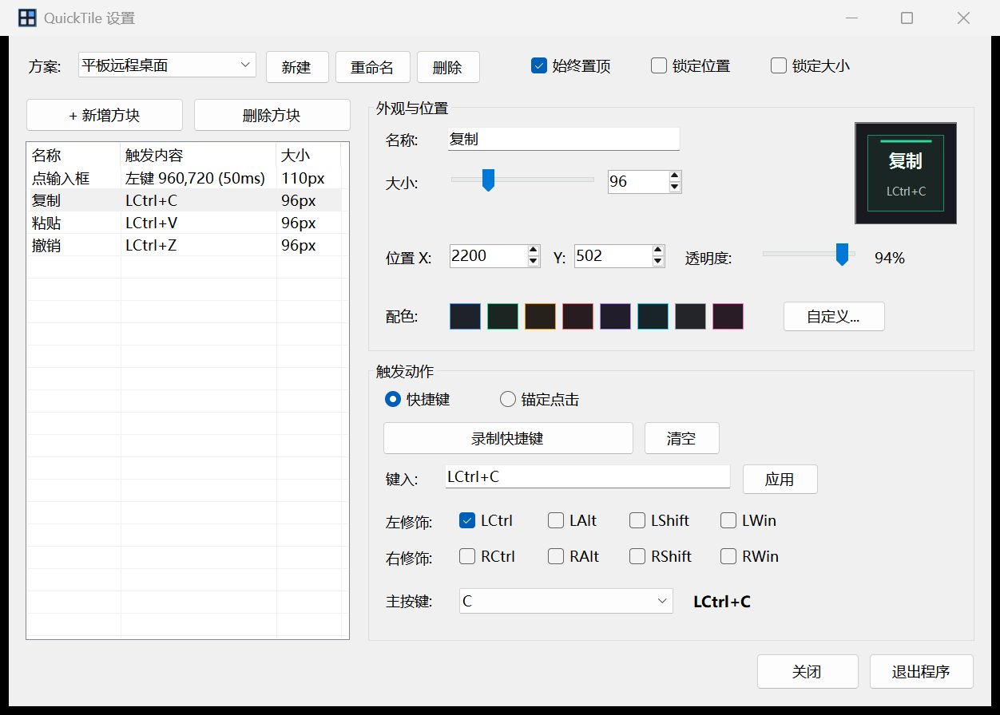
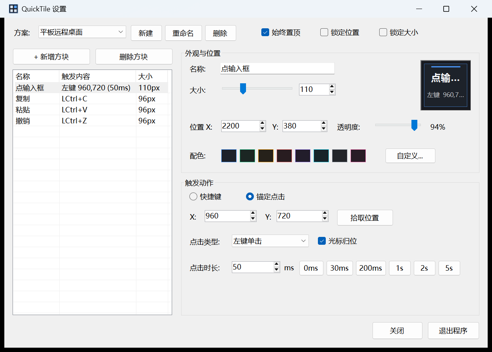

# QuickTile

[English](README.md) | [简体中文](README.zh-CN.md)

An ultra-lightweight, zero-dependency Windows **on-screen custom button** utility. Primarily designed to solve the pain point of **tiny, hard-to-tap UI buttons and awkward keyboard shortcuts when using a tablet over Remote Desktop** — place customizable, always-on-top square buttons anywhere on your screen to trigger shortcuts or anchored screen clicks **without stealing focus** from the active window.

## Screenshots



<details>
<summary>Settings UI (Hotkey & Anchor Click)</summary>




</details>

## Features

- **Built for Tablet & Remote Desktop Touch**: Enlarge hard-to-hit remote desktop buttons into comfortably sized on-screen square tiles (`28–320 px`) and place them wherever your thumb or stylus reaches easily.
- **Focus-Safe Triggering**: Uses `WS_EX_NOACTIVATE` and `WM_MOUSEACTIVATE (MA_NOACTIVATE)` so tapping any button sends its action without interrupting focus in your current window.
- **Minimalist Floating UI**: Starts silently with your active buttons on screen. Right-click any button (or click the system tray icon) to open **Settings**. Both the button context menu and tray menu stay minimal with 4 items: `设置` (Settings), `锁定大小` (Lock Size), `锁定位置` (Lock Position), and `退出程序` (Exit).
- **Multi-Profile Support**: Create, rename, switch, and delete button profiles directly from the top bar in Settings. Automatically enforces at least 1 profile and at least 1 button per profile.
- **Free Positioning & Independent Locks**:
  - Drag buttons anywhere across single or multi-monitor setups (including negative coordinates);
  - Resize `1:1` from the bottom-right corner or fine-tune by `4 px` with the mouse wheel;
  - `PerMonitorV2` DPI-aware with `WM_DPICHANGED` guarding to prevent scaling jumps across mixed-DPI monitors;
  - Independent **Lock Position** and **Lock Size** toggles, plus **Always On Top**.
- **Left/Right Modifier-Aware Hotkey Engine**:
  - Distinguishes `LCtrl` / `RCtrl`, `LAlt` / `RAlt`, `LShift` / `RShift`, and `LWin` / `RWin`;
  - Supports low-level keyboard hook (`WH_KEYBOARD_LL`) recording, manual hotkey text input (e.g., `LAlt+Y`, `RCtrl+Shift+S`), and individual modifier checkboxes;
  - Staged hardware `SendInput` injection with hardware scan codes and extended-key flags.
- **Anchored Screen Clicks**:
  - Multi-monitor translucent crosshair picker for physical pixel coordinates;
  - Emits a virtual-desktop hardware move (`MOUSEEVENTF_MOVE | MOUSEEVENTF_ABSOLUTE | MOUSEEVENTF_VIRTUALDESK`) before clicking;
  - Supports Left Click, Double Click, Right Click, configurable hold duration (`0–30000 ms`), and optional cursor position restoration.
- **Single-File Lightweight Build**: Pure .NET Framework 4.x WinForms + Win32 P/Invoke (`dist\QuickTile.exe`, ~97 KB) with bilingual UI (**中文 / English**) and zero external dependencies.

## Build

Requires Windows built-in .NET Framework 4.x `csc.exe` (`C:\Windows\Microsoft.NET\Framework64\v4.0.30319\csc.exe`) and PowerShell:

```powershell
powershell -ExecutionPolicy Bypass -File build.ps1
```

The compiled executable is output to `dist\QuickTile.exe`.

## Configuration

- **Default path**: `tiles.json` in the same directory as `QuickTile.exe` (can be overridden via the `QUICKTILE_CONFIG` environment variable).
- Uses an atomic multi-profile JSON format and automatically migrates legacy single-list `Tiles` configs into the default profile (`默认方案`).

## Contributors

- **JiewangCai** — Project author & requirements
- **Antigravity (Gemini)** — AI coding assistant

## License

[MIT](LICENSE)
