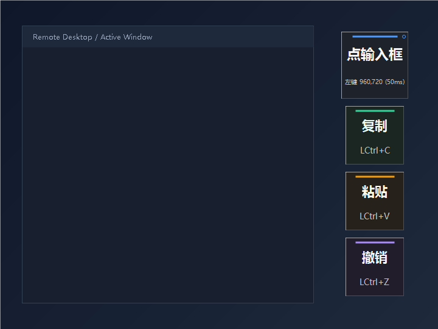
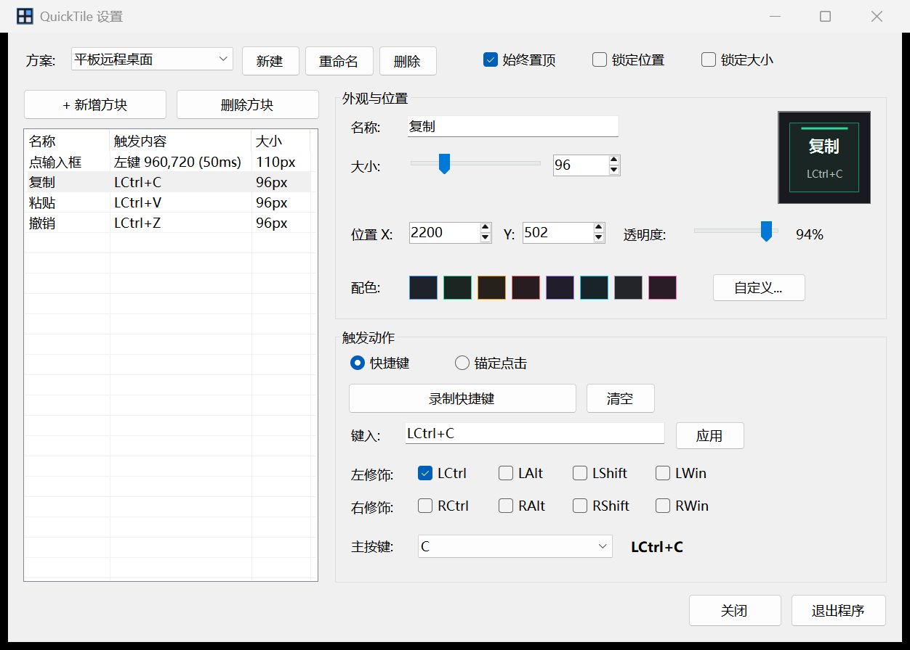
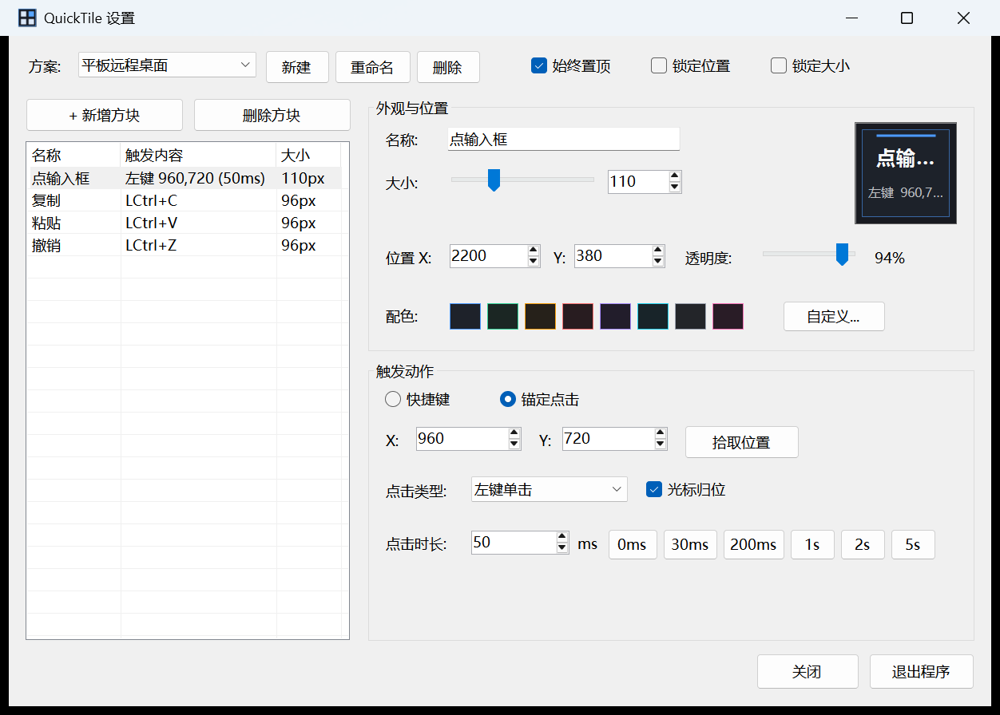

# QuickTile

[English](README.md) | [简体中文](README.zh-CN.md)

轻量级 Windows **屏幕自定义悬浮按钮**工具。主要为了解决**使用平板进行远程桌面操作时，部分小按钮难以点击、组合键不方便触发**的问题——你可以在屏幕上自由摆放、放大自定义的始终置顶正方形按钮，轻点即可触发快捷键或锚定点击指定屏幕坐标，且**不抢占当前窗口焦点**。

## 界面截图



<details>
<summary>设置界面（快捷键 / 锚定点击）</summary>




</details>

## 核心特性

- **专为平板远程桌面与触控优化**：将远程桌面里又小又难点的按钮或常用组合键，映射为屏幕上的大号自定义正方形按钮（支持 `28–320 px`），摆放在手指或触控笔最顺手的位置。
- **无焦点触发**：基于 `WS_EX_NOACTIVATE` + `WM_MOUSEACTIVATE (MA_NOACTIVATE)`，点击按钮时不打断当前窗口的输入焦点。
- **极简常驻交互**：启动后直接显示当前方案的悬浮按钮（右键任意按钮或点击托盘图标可打开 **设置**）；按钮右键菜单与托盘菜单均只保留 4 项：`设置`、`锁定大小`、`锁定位置`、`退出程序`。
- **多方案切换（Profiles）**：在设置界面顶部支持新建、重命名、切换与删除配置方案，并严格保障至少保留 1 个方案与 1 个按钮。
- **自由拖动与独立锁定**：
  - 未锁定时支持左键直接拖动至多显示器任意位置（支持负坐标）；
  - 支持右下角 `1:1` 拖拽缩放及鼠标滚轮 `4 px` 步进微调；
  - 开启 `PerMonitorV2` DPI 感知并拦截 `WM_DPICHANGED`，跨不同缩放比例显示器拖动不跳变；
  - **锁定位置** 与 **锁定大小** 彼此独立，并支持 **始终置顶**。
- **区分左右修饰键的快捷键引擎**：
  - 支持区分 `LCtrl` / `RCtrl`、`LAlt` / `RAlt`、`LShift` / `RShift`、`LWin` / `RWin`；
  - 支持底层键盘钩子（`WH_KEYBOARD_LL`）直接录制、快捷键文本手动键入（如 `LAlt+Y`、`RCtrl+Shift+S`）与勾选框精细调整；
  - 分段硬件 `SendInput` 注入，附带硬件扫描码与扩展键标志。
- **屏幕锚定点击**：
  - 跨多显示器半透明准星拾取物理屏幕像素坐标；
  - 点击前先发送虚拟桌面硬件移动（`MOUSEEVENTF_MOVE | MOUSEEVENTF_ABSOLUTE | MOUSEEVENTF_VIRTUALDESK`），再执行点击；
  - 支持左键单击 / 左键双击 / 右键单击、自定义点击按住时长（`0–30000 ms`）与点击后光标归位。
- **绝对轻量**：纯 .NET Framework 4.x WinForms + Win32 P/Invoke 单文件绿色可执行程序（`dist\QuickTile.exe`，约 `91.5 KB`），零第三方依赖。

## 编译构建

需要 Windows 自带的 .NET Framework 4.x `csc.exe`（位于 `C:\Windows\Microsoft.NET\Framework64\v4.0.30319\csc.exe`）与 PowerShell：

```powershell
powershell -ExecutionPolicy Bypass -File build.ps1
```

构建产物位于 `dist\QuickTile.exe`。

## 配置文件

- **默认路径**：程序同目录下的 `tiles.json`（可通过环境变量 `QUICKTILE_CONFIG` 指定自定义路径）。
- 采用原子替换写入的多方案 JSON 结构，并向下兼容旧版单列表 `Tiles` 格式（加载时自动迁移至“默认方案”）。

## 开源协议

[MIT](LICENSE)
